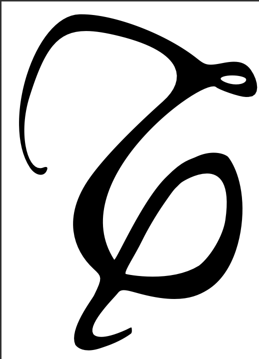
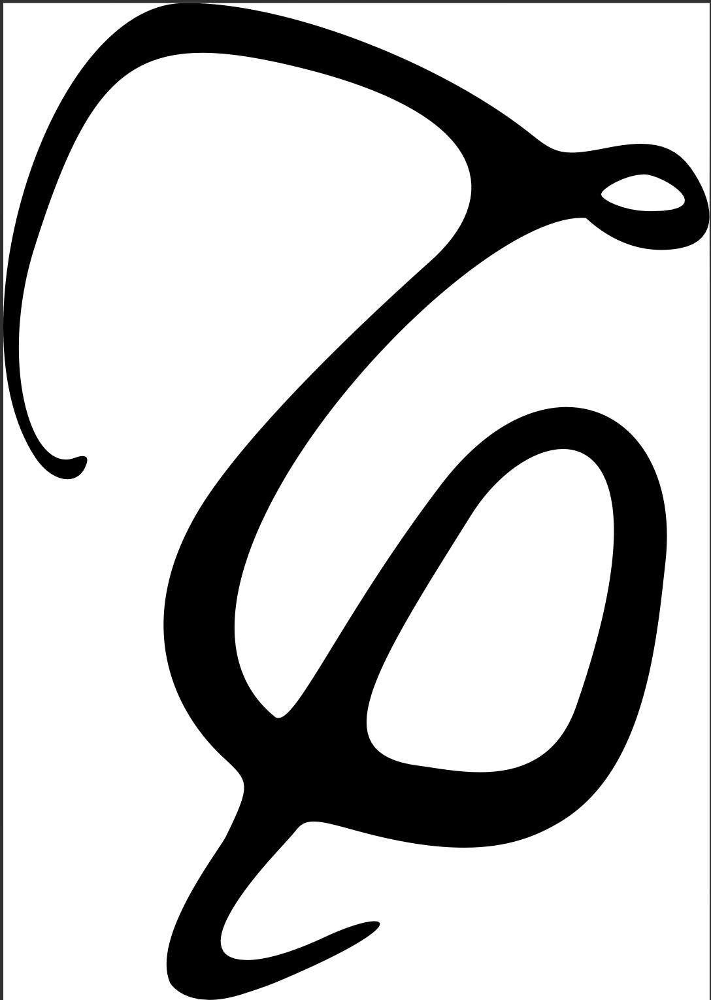

# mystyletau

Due nuovi simboli personalizzati per la topologia in LaTeX.

## Anteprima dei simboli

## Installazione rapida
1. Scarica il file `mystyletau.sty` da questo repository.
2. Copialo nella cartella del tuo documento `.tex`.
3. Aggiungi `\usepackage{mystyletau}` nel preambolo.

## Link ufficiali
- **CTAN:** [https://ctan.org/pkg/mystyletau](https://ctan.org/pkg/mystyletau)
